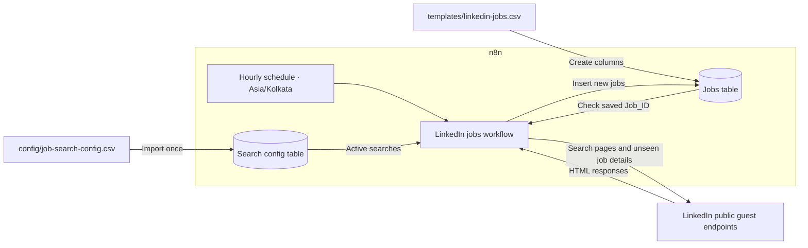
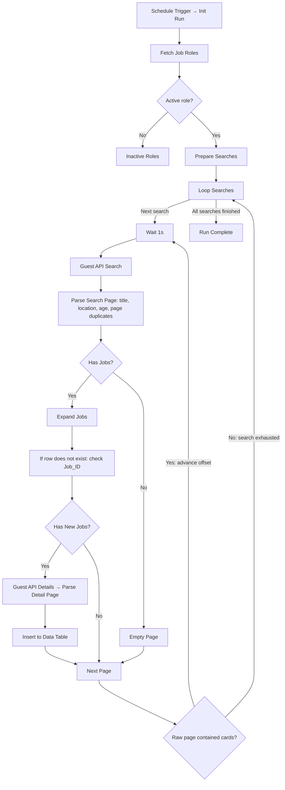

# LinkedIn Job Scraper with n8n

An hourly n8n workflow that searches public LinkedIn job listings, filters fresh matches, and saves new jobs to an n8n Data Table. The included configuration covers **six developer roles across Chennai, Tamil Nadu, and Bengaluru** (18 searches).

Runs at the start of each hour in **Asia/Kolkata**, requests newest-first listings from the last hour, and checks posting age before saving. Saved job IDs are checked before fetching details to avoid repeated work.

## Project structure

```text
.
├── README.md                         # Overview, diagrams, and setup
├── LICENSE                           # MIT license
├── config/
│   └── job-search-config.csv          # Roles, locations, and active flags
├── workflows/
│   └── linkedin-jobs-hourly.json      # Importable n8n workflow
├── templates/
│   └── linkedin-jobs.csv              # Header-only output table template
└── docs/
    └── HOW_IT_WORKS.md                # Processing, output schema, and limits
```

## Architecture

The CSV files initialize the tables. During execution, the workflow reads and writes **n8n Data Tables**, rather than the local CSV files.



## Workflow flowchart



A page with no **accepted** jobs can still contain raw cards, so pagination continues until the raw page is empty. Blocked or unrecognized responses, repeated pages, exhausted HTTP retries, and the pagination cap fail the execution; they are not treated as empty results.

## Setup

You need an n8n instance with Data Table support and outbound access to LinkedIn's public guest endpoints. This repository contains an importable workflow; there is no separate application to install or build.

1. Create a Data Table named `Personal_Job_Search_Config` and import [job-search-config.csv](config/job-search-config.csv). Use columns `keyword` and `location` as strings; `active` can be a string or boolean.
2. Create a Data Table named `Personal_LinkedIn_Jobs`. Use the 19 headers in [linkedin-jobs.csv](templates/linkedin-jobs.csv) as string columns, including `Job_ID`. If header-only import is unavailable, create the columns manually. See the [column reference](docs/HOW_IT_WORKS.md#output-columns).
3. Import [linkedin-jobs-hourly.json](workflows/linkedin-jobs-hourly.json) into n8n.
4. Select your config table in **Fetch Job Roles**. Select your jobs table in **If row does not exist** and **Insert to Data Table**. Replace the exported placeholder table IDs and verify all column mappings.
5. Run the workflow manually and inspect responses, saved rows, and execution status. Zero new rows is valid if no fresh matches exist.
6. Save and publish/activate the workflow. The export is inactive so the tables can be configured first. Keep one active writer to the output table and avoid overlapping manual and scheduled runs.

## Configuration

| Setting | Included value | Where to change it |
| --- | --- | --- |
| Roles | Full Stack Developer, Frontend Developer, Full Stack Engineer, Frontend Engineer, Software Developer, Software Engineer | Config Data Table |
| Locations | Chennai, Tamil Nadu, Bengaluru | Config Data Table; parser also enforces supported locations |
| Enabled searches | All 18 rows use `active=true` | Config Data Table |
| Schedule | `0 * * * *` | Schedule Trigger |
| Timezone | `Asia/Kolkata` | Workflow settings |
| Posting age | Strictly less than 60 minutes | Search request and Parse Search Page |
| Pagination cap | 20 pages per search | Prepare Searches |
| Request pacing | One second before each search page; one second between detail requests | Wait 1s and Guest API Details |
| Execution timeout | 55 minutes | Workflow settings |

After importing, edit the config **Data Table** to change active searches. Changing the CSV alone does not update n8n. Adding locations outside the supported regions also requires updating the location filter in **Parse Search Page**.

## Saved data and duplicate handling

Each saved row contains the job title, canonical link, company, location, source posting date/label, search keyword, description (up to 3,000 characters), and available job criteria or hiring-person information.

- `Job_ID` is the persisted duplicate-check key.
- `Dedup_Hash` stores the stable identifier `linkedin:<Job_ID>`.
- Existing IDs skip detail requests and insertion across pages, searches, and later runs.
- Check-then-insert is not atomic: concurrent runs can still create duplicates.

See [How it works](docs/HOW_IT_WORKS.md) for the complete output schema, age rules, failure behavior, and extension notes.

## Validation and limitations

This repository does not currently include an automated test suite. After import, verify table mappings, inspect a manual execution, and confirm that already saved IDs are skipped on a later run. A live n8n execution or LinkedIn scrape has not been performed as part of this documentation update.

LinkedIn can change its HTML, block requests, delay indexing, or omit precise posting times. The parser skips ambiguous ages, “1 hour ago” listings, and unsupported locations. The last-hour window is relative to each search request; delayed runs or outages can leave gaps, and there is no older-job backfill. Inspect failed executions before the next scheduled run. Telegram notifications are not configured.

## License

[MIT](LICENSE).
